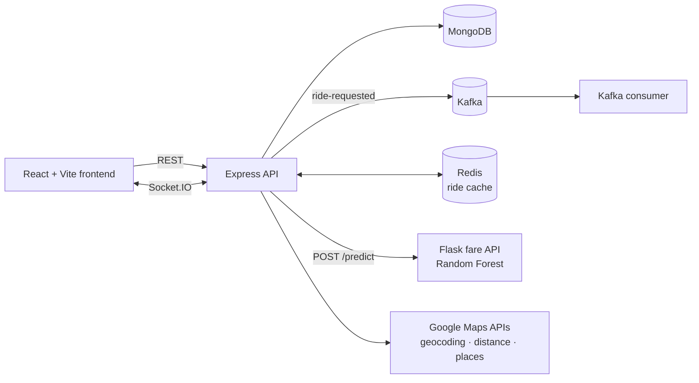

# Event-Driven Ride Booking

A ride-hailing platform with rider, driver ("captain") and admin apps. Ride requests are published to **Kafka**, ride state is cached in **Redis**, drivers and riders get live updates over **Socket.IO**, and fares come from a **scikit-learn** model served by a small Flask API.

## Features

- **Riders:** sign up and log in (JWT), search pickup and drop-off with Google Places autocomplete, get a fare estimate, request a ride, verify the driver with a 6-digit OTP, and view the payment summary and receipt.
- **Captains:** sign up with vehicle details, receive nearby ride requests in real time, accept rides, start them with the rider's OTP, finish them and stream their location.
- **Admins:** dashboard, captain and customer management, ride history, billing, analytics charts and support tickets.
- **Dynamic pricing:** a Random Forest model predicts the base fare from distance, passenger count and hour of day. The backend applies an evening (×1.5) or late-night (×1.3) surge and falls back to a distance-based formula if the model API is down.

## Architecture



**Ride request flow**
1. The rider requests a ride. The API calculates distance with the Google Distance Matrix API and prices it with the fare model.
2. The ride is saved to MongoDB with a generated OTP, cached in Redis under `ride:<id>` and published to the Kafka topic `ride-requested`.
3. The API finds captains within 10 miles of the pickup and pushes a `new-ride` event to each one over Socket.IO.
4. A captain accepts; the rider is notified in real time, and the ride starts once the captain enters the rider's OTP.

## Repository structure

```
event-driven-ride-booking/
├── docker-compose.yml        # Kafka, Zookeeper, Redis, MongoDB
├── Backend/
│   ├── server.js  app.js  socket.js
│   ├── routes/  controllers/  services/  models/  middlewares/
│   ├── kafka/                # producer + standalone consumer
│   ├── redis/                # Redis client
│   ├── ml/                   # fare model: train_model.py, fare_api.py, uber.csv
│   ├── seed.js               # sample users and captains
│   └── README.md             # API endpoint reference
└── frontend/
    └── src/
        ├── pages/            # rider, captain and admin screens
        └── components/       # ride panels, live tracking, media gallery
```

See [`Backend/README.md`](Backend/README.md) for request and response details of the user and captain endpoints.

## Run it locally

**Prerequisites:** Node.js 18+, Python 3.10+, Docker, and a Google Maps API key with the Geocoding, Distance Matrix and Places APIs enabled.

```bash
# 1. Start Kafka, Zookeeper, Redis and MongoDB
docker compose up -d

# 2. Train the fare model and start the fare API on port 5001
cd Backend/ml
pip install pandas scikit-learn flask joblib numpy
python train_model.py
python fare_api.py
```

In a second terminal:

```bash
# 3. Start the backend
cd Backend
cp .env.example .env          # add your JWT secret and Google Maps key
npm install
npm start                     # http://localhost:4000

# optional: log Kafka ride events
npm run kafka:consumer
```

In a third terminal:

```bash
# 4. Start the frontend
cd frontend
cp .env.example .env          # point VITE_BASE_URL at the backend
npm install
npm run dev                   # http://localhost:5173
```

`npm run seed` in `Backend/` loads sample users and captains. It deletes existing users and captains first, so only use it on a local database.

### Environment variables

| File | Variable | Purpose |
|---|---|---|
| `Backend/.env` | `PORT` | API port (defaults to 5000 if unset) |
| | `MONGO_URI` | MongoDB connection string |
| | `JWT_SECRET` | Secret for signing JWTs |
| | `GOOGLE_MAPS_API` | Google Maps key used by the backend |
| `frontend/.env` | `VITE_BASE_URL` | Backend URL used by the app |
| | `VITE_API_URL` | Backend URL used for logout |
| | `VITE_GOOGLE_MAPS_API_KEY` | Google Maps key for the live tracking map |

## Fare model

`Backend/ml/train_model.py` trains a `StandardScaler` + `RandomForestRegressor` pipeline on the included Uber trips dataset (`uber.csv`). It drops nulls and fares outside $0–$100, computes haversine trip distance in miles, extracts the pickup hour, and saves the model to `Backend/ml/models/fare_predictor.pkl`. `fare_api.py` serves it at `POST /predict` with a JSON body of `distance`, `passenger_count` and `hour`.

## Possible improvements

- Store captain locations as GeoJSON points with a `2dsphere` index. The 10-mile `$near` captain search needs that, and the current schema stores `{ ltd, lng }`.
- Move the Kafka and Redis hosts into environment variables (they are hardcoded to `localhost`).
- Have the Kafka consumer do real work, such as driver matching or analytics, instead of logging events.
- Add automated tests for the ride lifecycle.

## Tech stack

Node.js · Express · MongoDB (Mongoose) · Apache Kafka (kafka-node) · Redis · Socket.IO · JWT · React · Vite · Tailwind CSS · Recharts · Google Maps APIs · Python · Flask · scikit-learn · Docker Compose
